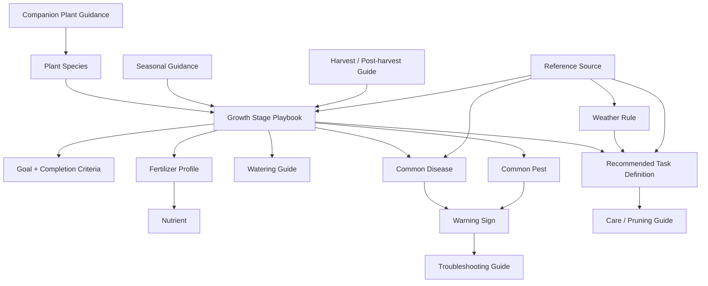
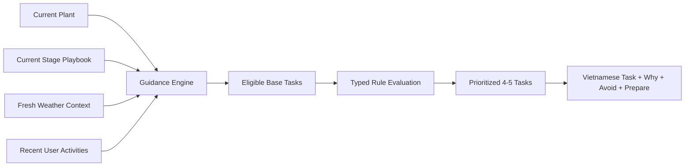

# Knowledge Base architecture

## 1. Purpose

The Knowledge Base supplies reviewed, reusable plant-care knowledge for stage guidance, deterministic recommendations, progressive teaching, and future AI assistance.

It is not a database schema and never stores user plants, task completion, weather observations, journal entries, photos, or reminders.

The same domain model must work with Markdown in MVP, PostgreSQL or a CMS later, and a vector index for RAG without changing the application's knowledge interface.

## 2. Design principles

- **Guide first:** knowledge must resolve into useful action, not only descriptive articles.
- **Stage-centered:** the current growth stage selects the relevant playbook and limits information overload.
- **Explain why:** every recommended task links to a reviewed reason.
- **Compose, do not copy:** playbooks reference reusable tasks, guides, fertilizers, nutrients, diseases, pests, and rules.
- **Deterministic before generative:** executable rules remain typed and testable; AI may explain or personalize later.
- **Evidence-backed:** agronomic claims include sources, review status, and review dates.
- **Locale-aware:** stable IDs are language-neutral; user-facing MVP content is Vietnamese.
- **Offline-ready:** approved grape knowledge can be compiled and bundled with the mobile app.
- **Safe evolution:** IDs are immutable, versions are explicit, and deprecated content remains traceable.

## 3. Knowledge, context, and output boundaries

| Class | Examples | Ownership |
| --- | --- | --- |
| Curated knowledge | Species, stages, task definitions, nutrients, threats, guides, rules | Knowledge Base |
| Runtime context | Current plant, stage, weather, recent activities, local date | User/external data |
| Generated output | Today's recommended tasks, reasons, weather adjustments | Guidance module |
| User history | Completed tasks, manual activities, notes, photos | User data |

Rules consume runtime context but are themselves curated knowledge. Generated tasks reference knowledge versions but are user-specific data.

## 4. Domain relationship map



### Recommendation derivation



## 5. Domain catalog

### 5.1 Plant Species

**Purpose:** Defines stable species identity and the ordered stage journey.

**Required fields:** ID, Vietnamese name, scientific name, summary, supported locales, stage IDs, lifecycle type, status, version, references.

**Optional fields:** Common names, climate preferences, growing methods, image references, difficulty, companion guidance, default units.

**Relationships:** Owns stage order; references species-level guides, threats, seasonal guidance, harvest, and companion content.

**Example:** `plant.grape` / “Nho” / `Vitis vinifera`, with stages from “Cây con” through “Sau thu hoạch”.

### 5.2 Growth Stage Playbook

**Purpose:** Provides the complete guidance context for one species stage. This is the heart of the system.

**Required fields:**

- ID, species ID, sequence, Vietnamese name, description, and goal;
- entry criteria and observable completion criteria;
- recommended task IDs;
- watering-guide and fertilizer-profile references;
- recommended nutrient IDs;
- things to avoid;
- weather considerations;
- common disease, pest, and warning-sign IDs;
- success indicators;
- next-stage ID or terminal marker;
- status, version, review metadata, and references.

**Optional fields:** Typical duration range, climate/growing-method variants, pruning guides, seasonal notes, harvest/post-harvest guides, images, expert notes.

**Relationships:** Belongs to Species; composes tasks and guides; references threats and rules; transitions to the next stage.

**Example:** `grape.stage.trunk-development`, shown as “Nuôi thân”, with goal “Phát triển thân chính khỏe và thẳng”.

### 5.3 Completion Criterion

**Purpose:** Gives users observable evidence for stage progress without automatic stage advancement.

**Required fields:** Stable child ID, Vietnamese label, observation method, required/optional flag, display order.

**Optional fields:** Threshold, unit, supporting image, caution, linked guide.

**Relationships:** Embedded in one Stage Playbook; user data stores checked state by criterion ID and playbook version.

**Example:** `main-trunk-reaches-trellis` / “Thân chính đã chạm tới giàn”.

### 5.4 Recommended Task Definition

**Purpose:** Defines a reusable action the Guidance Engine may instantiate for a user.

**Required fields:** ID, Vietnamese title, activity type, instruction, reason, applicable species/stages, eligibility, repeat policy, completion behavior, status, version, references.

**Optional fields:** Preparation, avoid text, care-guide IDs, fertilizer/watering references, estimated effort, photo suggestion, priority, weather-rule IDs.

**Relationships:** Referenced by Stage Playbooks; modified by Weather Rules; may reference guides, fertilizers, nutrients, diseases, or pests.

**Example:** `grape.task.tie-main-trunk` / “Buộc thân vào giàn” / reason “Giúp thân chính phát triển thẳng và giảm nguy cơ gãy khi có gió.”

### 5.5 Care Guide

**Purpose:** Explains a reusable care technique shared across tasks or stages.

**Required fields:** ID, guide type, Vietnamese title, purpose, steps, safety/avoid notes, applicable species/stages, status, version, references.

**Optional fields:** Tools, materials, images, duration, difficulty, climate variants, related tasks, troubleshooting links.

**Relationships:** Referenced by tasks, stages, troubleshooting, harvest, and seasonal content.

**Example:** `guide.tie-vine-to-support` with steps for selecting soft ties and avoiding stem constriction.

### 5.6 Watering Guide

**Purpose:** Describes how users should assess and perform watering for a species/stage rather than prescribing unsafe universal volume.

**Required fields:** ID, species/stage scope, assessment method, action guidance, avoid conditions, weather-rule IDs, status, version, references.

**Optional fields:** Amount range with unit and assumptions, soil/growing-method variants, time-of-day guidance, drainage checks, warning signs.

**Relationships:** Referenced by stages and watering tasks; modified by weather and recent watering history.

**Example:** “Kiểm tra lớp đất mặt; tưới khi đất bắt đầu khô. Hoãn tưới nếu dự báo mưa lớn và chậu thoát nước chậm.”

### 5.7 Pruning Guide

**Purpose:** Defines stage-specific pruning intent, technique, and safety constraints.

**Required fields:** ID, species/stage scope, goal, target growth, steps, avoid list, tool hygiene, status, version, references.

**Optional fields:** Diagrams, season constraints, recovery guidance, linked diseases, warning signs.

**Relationships:** Referenced by pruning tasks and stage playbooks.

**Example:** A “Nuôi thân” guide that removes competing side shoots while explicitly avoiding cutting the main trunk.

### 5.8 Fertilizer Profile

**Purpose:** Describes an agronomic fertilizer category or composition without requiring a commercial brand.

**Required fields:** ID, Vietnamese name, fertilizer type, nutrient composition, intended purpose, applicable species/stages, application methods, cautions, status, version, references.

**Optional fields:** NPK range, amount range with unit and assumptions, organic/synthetic classification, compatibility, example product names.

**Relationships:** Composes Nutrients; referenced by stages, fertilizing tasks, troubleshooting, and weather rules.

**Example:** `fertilizer.nitrogen-forward-balanced` for vegetative growth, with over-fertilization cautions.

### 5.9 Nutrient

**Purpose:** Defines the role, deficiency indicators, excess risks, and source categories for one plant nutrient.

**Required fields:** ID, Vietnamese name, symbol, role, deficiency signs, excess risks, source categories, status, version, references.

**Optional fields:** Mobility, interactions, stage relevance, related troubleshooting guides.

**Relationships:** Used by Fertilizer Profiles, stages, warning signs, and troubleshooting.

**Example:** `nutrient.potassium` / “Kali” with fruit-development relevance and cautions against assuming deficiency from one symptom.

### 5.10 Disease

**Purpose:** Provides reviewed disease context, recognizable signs, risk conditions, prevention, and escalation guidance without claiming diagnosis.

**Required fields:** ID, Vietnamese name, affected species/stages, warning-sign IDs, risk conditions, prevention, safe first response, escalation criteria, status, version, references.

**Optional fields:** Scientific/pathogen name, images, weather-rule IDs, differential problems, regional scope, expert treatment guidance.

**Relationships:** Referenced by stages, Warning Signs, Troubleshooting Guides, seasonal content, and Weather Rules.

**Example:** A grape powdery-mildew document linked to white coating signs, humid conditions, airflow guidance, and expert escalation.

### 5.11 Pest

**Purpose:** Describes a pest, evidence of presence, risk periods, prevention, and safe response.

**Required fields:** ID, Vietnamese name, affected species/stages, warning-sign IDs, damage pattern, prevention, safe first response, escalation criteria, status, version, references.

**Optional fields:** Scientific name, lifecycle, images, beneficial lookalikes, seasonal scope, treatment guide.

**Relationships:** Referenced by stages, Warning Signs, Troubleshooting Guides, and Seasonal Guidance.

**Example:** `pest.aphid` / “Rệp mềm”, linked to curled young leaves and sticky residue.

### 5.12 Warning Sign

**Purpose:** Represents an observable condition without prematurely deciding its cause.

**Required fields:** ID, Vietnamese label, observation description, affected plant parts, urgency, possible disease/pest/nutrient IDs, status, version, references.

**Optional fields:** Images, stage relevance, weather context, questions for the user.

**Relationships:** Links observations to multiple possible causes and Troubleshooting Guides.

**Example:** `sign.yellow-young-leaves` / “Lá non bị vàng”; possible causes remain plural until evidence improves.

### 5.13 Troubleshooting Guide

**Purpose:** Guides a safe investigation from an observed sign to checks, low-risk actions, and escalation.

**Required fields:** ID, Vietnamese title, starting warning-sign IDs, diagnostic questions, ordered checks, safe actions, stop/escalate conditions, status, version, references.

**Optional fields:** Possible-cause ranking, stage/weather variants, images, linked care guides.

**Relationships:** Connects Warning Signs with diseases, pests, nutrients, watering, and care guides.

**Example:** “Lá non bị vàng” asks about watering, recent fertilizer, leaf pattern, and pest evidence before suggesting any cause.

### 5.14 Weather Rule

**Purpose:** Modifies a known task using normalized weather facts. It does not create free-form agronomic advice.

**Required fields:** ID, scope, priority, typed conditions, target task/activity, allowed effect, Vietnamese explanation, fallback behavior, status, version, references.

**Optional fields:** Stage/species scope, valid forecast window, conflict group, safety severity, related guide.

**Relationships:** Targets Recommended Task Definitions and may reference stages, diseases, fertilizers, or care guides.

**Example:** Flowering + rain probability above 70% delays a spraying task and explains “Mưa có thể làm giảm hiệu quả phun.”

### 5.15 Seasonal Guidance

**Purpose:** Adds climate/season context that is broader than today's weather.

**Required fields:** ID, species scope, climate/region scope, season definition, guidance, relevant stage/task IDs, status, version, references.

**Optional fields:** Month range, hemisphere, weather patterns, preparation checklist, threat links.

**Relationships:** Supplements stages, tasks, diseases, pests, harvest, and post-harvest guides.

**Example:** Rainy-season grape guidance emphasizing airflow, drainage, observation frequency, and spray timing cautions.

### 5.16 Harvest Guide

**Purpose:** Explains readiness indicators, safe harvesting, quality checks, and immediate handling.

**Required fields:** ID, species scope, readiness indicators, harvest method, avoid list, post-harvest guide ID, status, version, references.

**Optional fields:** Variety differences, tools, timing, quality grading, images.

**Relationships:** Referenced by harvest stages and transitions into Post-harvest Guidance.

**Example:** Grape harvest readiness based on reviewed visual/taste indicators rather than calendar days alone.

### 5.17 Post-harvest Guide

**Purpose:** Guides plant recovery, sanitation, storage, and preparation for the next cycle.

**Required fields:** ID, species scope, immediate actions, plant-care actions, sanitation, avoid list, next-stage ID, status, version, references.

**Optional fields:** Storage guidance, pruning links, nutrient guidance, dormancy/climate variants.

**Relationships:** Follows Harvest Guide and links to the next stage playbook.

**Example:** “Sau thu hoạch” guidance for removing damaged material, reviewing plant health, and preparing the next growth cycle.

### 5.18 Companion Plant Guidance

**Purpose:** Records evidence-backed beneficial, neutral, or harmful plant relationships. This is future scope.

**Required fields:** ID, primary species, companion species, relationship type, rationale, constraints, status, version, references.

**Optional fields:** Distance, climate, pest interactions, growing-method scope.

**Relationships:** Referenced by Plant Species and future garden-planning features.

**Example:** A reviewed companion relationship with clear growing conditions, not a generic folklore claim.

### 5.19 Reference Source

**Purpose:** Preserves provenance for claims, rules, and review decisions.

**Required fields:** ID, title, publisher/author, source type, publication date when known, locator/URL, accessed date, review notes.

**Optional fields:** DOI, edition, language, archived URL, expert reviewer, applicable region.

**Relationships:** Referenced by every publishable knowledge document.

**Example:** An agricultural-extension guide used to support grape flowering and disease-risk guidance.

## 6. Recommendation generation model

### Inputs

- Plant species and current stage.
- User-confirmed stage criteria.
- Local date and timezone.
- Recent completed/skipped tasks and journal activities.
- Fresh-enough normalized weather.
- Approved playbook and rule versions.

### Pipeline

1. Load the approved species and current Stage Playbook.
2. Resolve referenced task definitions and care content.
3. Evaluate task eligibility and repeat policy against recent history.
4. Apply seasonal constraints.
5. Apply weather rules.
6. Apply safety suppression and rule-conflict resolution.
7. Rank by safety, stage importance, due state, and fatigue limits.
8. Return at most 4–5 tasks with reason, avoid text, preparation, and provenance.
9. Persist user-specific task instances outside the Knowledge Base.

### Example derivation

```text
Plant: Nho ban công
Stage: Ra hoa
Weather: Mưa lớn có khả năng xảy ra ngày mai
History: Chưa phun trong 10 ngày

Base tasks:
- Theo dõi hoa
- Kiểm tra độ ẩm đất
- Phun phòng theo hướng dẫn

Weather effects:
- Hoãn phun
- Giảm ưu tiên tưới

Output:
- Quan sát hoa — “Theo dõi khả năng đậu quả và dấu hiệu bất thường.”
- Kiểm tra độ ẩm đất — “Chỉ tưới nếu đất bắt đầu khô; ngày mai có khả năng mưa lớn.”
- Tránh phun hôm nay — “Mưa có thể làm giảm hiệu quả phun.”
```

## 7. Human-readable rule system

### Supported facts

Facts use a controlled namespace:

- `plant.species_id`
- `plant.stage_id`
- `plant.growing_method`
- `weather.rain_probability`
- `weather.heavy_rain_expected`
- `weather.temperature_c`
- `weather.humidity_percent`
- `history.days_since.<activity_type>`
- `history.last_product_id.<activity_type>`
- `calendar.season_id`
- `task.definition_id`

### Supported operators

- `equals`, `not_equals`
- `in`, `not_in`
- `greater_than`, `greater_than_or_equal`
- `less_than`, `less_than_or_equal`
- `exists`, `not_exists`

Conditions may use one `all` group and one nested `any` group. Arbitrary scripts, recursion, and user-authored expressions are not allowed.

### Supported effects

- `recommend_task`
- `prioritize_task`
- `delay_task`
- `suppress_task`
- `annotate_task`
- `show_warning`

Every effect includes a user-facing Vietnamese explanation. Delay/suppress effects require fallback behavior and stronger review than an annotation.

### Conflict resolution

1. Safety suppression wins over recommendation.
2. Higher safety severity wins.
3. More specific species + stage rules win over global rules.
4. Higher explicit priority wins.
5. Equal unresolved effects fail validation; publishing is blocked.

### Rule example

```yaml
id: grape.rule.delay-spray-before-heavy-rain
type: weather_rule
version: 1.0.0
status: approved
scope:
  species_ids: [plant.grape]
  stage_ids: [grape.stage.flowering]
when:
  all:
    - fact: weather.rain_probability
      operator: greater_than
      value: 70
    - fact: task.activity_type
      operator: equals
      value: spraying
then:
  effect: delay_task
  message_vi: "Nên hoãn phun vì mưa có thể làm giảm hiệu quả."
  fallback: keep_visible_as_avoid
priority: 80
references: [ref.extension.grape-spray-rain]
last_reviewed: 2026-07-11
```

### History-based example

```yaml
id: grape.rule.fruit-stage-potassium-review
type: history_rule
version: 1.0.0
status: review
scope:
  species_ids: [plant.grape]
  stage_ids: [grape.stage.fruit-development]
when:
  all:
    - fact: history.days_since.fertilizing
      operator: greater_than
      value: 14
then:
  effect: recommend_task
  task_definition_id: grape.task.review-potassium-feeding
  message_vi: "Đã hơn 14 ngày từ lần bón phân gần nhất. Hãy kiểm tra nhu cầu dinh dưỡng trước khi bón."
priority: 50
references: [ref.expert.grape-fruit-nutrition]
```

The task says “review” rather than automatically prescribing fertilizer. The user still needs stage, product, plant, and safety context.

## 8. Markdown storage architecture

```text
knowledge/
├── _schemas/
│   ├── common.schema.json
│   ├── species.schema.json
│   ├── stage-playbook.schema.json
│   ├── task-definition.schema.json
│   └── rule.schema.json
├── _taxonomies/
│   ├── activity-types.md
│   ├── climate-zones.md
│   ├── difficulty-levels.md
│   └── safety-levels.md
├── species/
│   └── grape/
│       ├── species.md
│       ├── stages/
│       │   ├── seedling.md
│       │   ├── trunk-development.md
│       │   ├── flowering.md
│       │   └── post-harvest.md
│       ├── tasks/
│       ├── guides/
│       │   ├── watering/
│       │   ├── pruning/
│       │   ├── harvest/
│       │   └── post-harvest/
│       ├── seasonal/
│       └── rules/
├── catalogs/
│   ├── nutrients/
│   ├── fertilizers/
│   ├── diseases/
│   ├── pests/
│   └── warning-signs/
├── guides/
│   ├── care/
│   ├── troubleshooting/
│   └── companion-plants/
├── rules/
│   └── weather/
├── references/
└── _generated/
    ├── manifest.json
    ├── relationship-graph.json
    └── mobile-bundle.json
```

Species-specific content lives together for authoring and review. Reusable catalogs prevent duplicated nutrient, threat, and fertilizer definitions.

`_generated` is build output, not authored content. CI resolves references and produces a validated graph and offline bundle.

Adding another species repeats the directory contract under `species/<slug>/`; it does not add new application modules.

## 9. Metadata standard

### Required frontmatter

```yaml
id: grape.stage.trunk-development
type: growth_stage_playbook
title: "Nuôi thân"
locale: vi-VN
species_ids: [plant.grape]
stage_ids: [grape.stage.trunk-development]
tags: [grape, vegetative-growth, trunk-training]
difficulty: beginner
safety_level: standard
version: 1.0.0
status: approved
reviewed_by: [expert.nguyen-van-a]
last_reviewed: 2026-07-11
references: [ref.extension.grape-training]
related_documents:
  - grape.task.tie-main-trunk
  - guide.tie-vine-to-support
```

### Metadata rules

- `id` is immutable, globally unique, lowercase, and language-neutral.
- `type` comes from a controlled content-type registry.
- `locale` identifies user-facing content language.
- `version` follows semantic content versioning.
- `status` is `draft`, `review`, `approved`, `deprecated`, or `archived`.
- `reviewed_by` and `references` are required before approval.
- `last_reviewed` drives stale-content reporting.
- `related_documents` creates explicit graph edges.
- Climate, region, growing method, and variety are optional scope metadata, never hidden assumptions.

### Semantic content versioning

- Patch: wording or formatting with no guidance change.
- Minor: additive guidance or relationships that preserve meaning.
- Major: changed recommendation, criteria, rule effect, safety instruction, or stage transition.

Generated user tasks store the knowledge ID and version used at generation time.

## 10. Content templates

### Stage playbook template

```md
---
id: grape.stage.trunk-development
type: growth_stage_playbook
title: "Nuôi thân"
locale: vi-VN
species_ids: [plant.grape]
version: 1.0.0
status: review
references: [ref.extension.grape-training]
---

# Nuôi thân

## Mục tiêu

Phát triển thân chính khỏe, thẳng và đạt tới giàn.

## Mô tả

Giai đoạn tập trung vào một thân chính và nền tảng cho tán cây sau này.

## Điều kiện bắt đầu

- Cây đã bén rễ và xuất hiện chồi khỏe.

## Tưới nước

- Tham chiếu: `grape.watering.trunk-development`

## Phân bón và dinh dưỡng

- Tham chiếu: `fertilizer.nitrogen-forward-balanced`
- Dinh dưỡng: `nutrient.nitrogen`

## Công việc đề xuất

- `grape.task.tie-main-trunk`
- `grape.task.remove-competing-shoots`
- `grape.task.check-soil-moisture`

## Điều cần tránh

- Không cắt ngọn thân chính.
- Không để nhiều thân cạnh tranh.

## Vấn đề thường gặp

- `sign.yellow-young-leaves`
- `pest.aphid`

## Tiêu chí hoàn thành

- `main-trunk-reaches-trellis`: Thân chính đã chạm tới giàn.
- `main-trunk-is-secure`: Thân được cố định an toàn và không bị siết.

## Giai đoạn tiếp theo

`grape.stage.climbing-trellis`
```

### Task template

```md
---
id: grape.task.tie-main-trunk
type: recommended_task_definition
title: "Buộc thân vào giàn"
locale: vi-VN
species_ids: [plant.grape]
stage_ids: [grape.stage.trunk-development]
activity_type: training
repeat_policy: event_or_observation_based
version: 1.0.0
status: approved
references: [ref.extension.grape-training]
---

## Hướng dẫn

Buộc nhẹ thân chính vào điểm tựa bằng dây mềm.

## Vì sao nên làm

Giúp thân phát triển thẳng và giảm nguy cơ gãy khi có gió.

## Điều cần tránh

Không buộc quá chặt vào thân.

## Chuẩn bị tiếp theo

Kiểm tra lại điểm buộc sau 3–5 ngày.
```

### Threat template

```md
---
id: disease.grape.powdery-mildew
type: disease
title: "Bệnh phấn trắng trên nho"
locale: vi-VN
species_ids: [plant.grape]
warning_sign_ids: [sign.white-powdery-coating]
version: 1.0.0
status: review
references: [ref.extension.grape-powdery-mildew]
---

## Dấu hiệu có thể quan sát

Mảng trắng dạng bột xuất hiện trên lá hoặc chồi non.

## Điều kiện rủi ro

Tán thiếu thông thoáng và điều kiện ẩm phù hợp cho bệnh phát triển.

## Hành động an toàn ban đầu

Cách ly vật liệu bị ảnh hưởng khi phù hợp, cải thiện thông thoáng và tham khảo hướng dẫn đã được duyệt.

## Khi nào cần chuyên gia

Triệu chứng lan nhanh, ảnh hưởng chùm quả hoặc không thể phân biệt với nguyên nhân khác.
```

## 11. Validation and publishing

### Structural validation

- Frontmatter matches the content-type schema.
- IDs are unique and immutable.
- Every relationship resolves.
- Stage order is complete and has no unintended cycles.
- Every non-terminal stage has a valid next stage.
- Task and rule facts/operators/effects use allowlists.
- Rule conflicts resolve deterministically.
- Vietnamese user content exists for approved MVP documents.

### Knowledge-quality validation

- Every recommendation has a reason.
- Every avoid/safety statement has a source.
- Amounts include units and assumptions.
- Disease and pest content avoids unsupported diagnosis.
- Stage criteria are observable by the target user.
- Guidance distinguishes fact, uncertainty, and escalation.
- Review dates are within the content-type policy.

### Publishing pipeline

1. Validate schemas and relationships.
2. Run rule scenario tests.
3. Generate the relationship graph.
4. Generate a Vietnamese offline bundle.
5. Generate RAG chunks and metadata.
6. Produce a content-change report.
7. Require expert approval for safety-impacting changes.
8. Publish an immutable content version.

## 12. Repeatable expert authoring workflow

1. Register sources and reviewers.
2. Create Plant Species identity and scope.
3. Define the ordered growth-stage journey.
4. Write one complete Stage Playbook at a time.
5. Reuse or create task definitions and care guides.
6. Link nutrients and fertilizer profiles.
7. Link common diseases, pests, signs, and troubleshooting.
8. Add seasonal and weather rules.
9. Add harvest and post-harvest guidance when relevant.
10. Run validation and scenario previews.
11. Review Vietnamese user presentation.
12. Approve and publish the species content version.

### Definition of done for a new species

- All supported stages form a valid ordered journey.
- Every stage has a goal, action, avoid list, criteria, and next-stage behavior.
- Every generated task explains why.
- Required reusable references exist and resolve.
- Weather and history scenarios produce safe bounded outputs.
- At least one expert approves all safety-impacting content.
- The mobile preview contains no missing Vietnamese copy.

## 13. Future persistence mapping

The application depends on `KnowledgeRepository`, not Markdown paths. Persistence changes replace adapters while preserving domain IDs, relationships, and content types.

| Knowledge concept | Markdown MVP | PostgreSQL | CMS | Vector/RAG |
| --- | --- | --- | --- | --- |
| Document | Markdown + frontmatter | Typed content row/document | Content type entry | Source document |
| Relationship | Stable ID reference | Foreign key/edge table | Reference field | Metadata edge |
| Version | Git + frontmatter | Immutable version/revision | CMS revision | Version metadata |
| Locale | Separate locale document | Locale column/translation table | Localization | Locale filter |
| Rule | Structured frontmatter/YAML | Typed rule record | Restricted rule form | Not executed from vectors |
| Approval | Pull request/reviewer | Workflow state/audit | Editorial workflow | Inherit approved source status |

### PostgreSQL evolution

Use typed collections or tables for content documents, versions, localized bodies, relationships, sources, and rules. Preserve current IDs and version semantics.

Do not expose persistence rows to the app. A PostgreSQL adapter returns the same domain documents as the Markdown adapter.

### CMS evolution

Mirror the content types and controlled relationships. Editors use forms for metadata and structured rule fields, while rich guidance remains author-friendly.

Publishing from the CMS runs the same validation, graph generation, bundle generation, and review gates.

## 14. AI and RAG readiness

### RAG source policy

Only approved knowledge versions enter the vector index. Draft, deprecated, unsupported-locale, or stale high-risk content is excluded.

Rules are executed by the deterministic engine, never reconstructed from vector similarity. RAG may retrieve explanations and evidence but cannot bypass safety rules.

### Self-contained documents

Each document begins with enough context to stand alone: species, stage, purpose, scope, assumptions, and key relationships.

References use stable IDs, and the indexing pipeline may resolve selected labels/summaries into chunk context without copying full documents.

### Chunking strategy

- Species: overview, lifecycle/stage map, general constraints.
- Stage Playbook: one overview chunk plus one chunk per major section.
- Task: one atomic chunk containing instruction, reason, avoid, preparation, and scope.
- Disease/Pest: signs, risks, prevention, safe response, escalation as separate chunks.
- Troubleshooting: one chunk per decision path or starting sign.
- Guides: one chunk per procedure or safety section.
- Rules: index explanation/provenance for citation, but execute only structured source.

Each chunk repeats document ID, version, locale, species, stage, content type, safety level, review date, and source IDs.

Target chunks should usually remain 200–500 tokens with small overlap only when a procedure crosses section boundaries.

### Retrieval filters

Filter before semantic ranking by locale, approval status, species, stage, safety policy, content version, region/climate when known, and allowed content types.

### Future AI recommendation context

An AI assistant may combine:

- structured user history;
- current plant and stage;
- fresh weather with timestamp;
- deterministic baseline tasks and rule outcomes;
- retrieved approved Knowledge Base chunks.

AI output must cite knowledge IDs/versions, distinguish observations from inference, preserve deterministic safety constraints, and disclose missing or stale context.

## 15. Scalability safeguards

- Adding a species adds content, not application modules.
- Shared catalogs prevent repeated nutrient, fertilizer, threat, and sign definitions.
- Species/stage overrides remain explicit and more specific than global guidance.
- Stable IDs survive Markdown, PostgreSQL, CMS, and vector migration.
- Typed rules prevent an unreviewable scripting platform.
- Content compilation catches broken links before release.
- Versions keep generated tasks and journal explanations historically traceable.
- Editorial workflow and source metadata scale independently from mobile releases.
