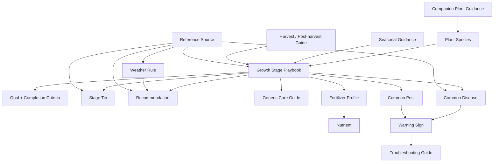
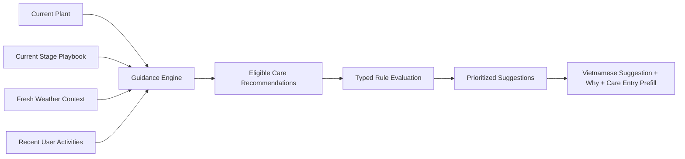

# Knowledge Base architecture

## 1. Purpose

The Knowledge Base supplies reviewed, reusable plant-care knowledge for stage tips, deterministic care suggestions, progressive teaching, and future AI assistance.

It is not a database schema and never stores user plants, suggestion state, weather observations, journal entries, photos, or reminders.

The same domain model must work with Markdown in MVP, PostgreSQL or a CMS later, and a vector index for RAG without changing the application's knowledge interface.

## 2. Design principles

- **Useful context:** knowledge should support decisions without turning every tip into a task.
- **Stage-centered:** the current growth stage selects the relevant playbook and limits information overload.
- **Explain why:** every care suggestion links to a reviewed reason.
- **Compose, do not copy:** playbooks reference reusable tips, care recommendations, guides, fertilizers, nutrients, diseases, pests, and rules.
- **Deterministic before generative:** executable rules remain typed and testable; AI may explain or personalize later.
- **Evidence-backed:** agronomic claims include sources, review status, and review dates.
- **Locale-aware:** stable IDs are language-neutral; user-facing MVP content is Vietnamese.
- **Offline-ready:** approved grape knowledge can be compiled and bundled with the mobile app.
- **Safe evolution:** IDs are immutable, versions are explicit, and deprecated content remains traceable.

## 3. Knowledge, context, and output boundaries

| Class             | Examples                                                                       | Ownership          |
| ----------------- | ------------------------------------------------------------------------------ | ------------------ |
| Curated knowledge | Species, stages, tips, care recommendations, nutrients, threats, guides, rules | Knowledge Base     |
| Runtime context   | Current plant, stage, weather, recent activities, local date                   | User/external data |
| Generated output  | Ephemeral care suggestions, reasons, weather adjustments, Care Entry prefills  | Guidance module    |
| User history      | Explicitly saved activities, notes, photos                                     | User data          |

Rules consume runtime context but are themselves curated knowledge. Derived suggestions are transient read models; only explicitly saved care becomes user history.

User Fertilizers managed through Care Entry or “Mở rộng” are private reusable user data. Fertilizer applications entered inside Care Entry are user history. Neither creates, updates, or approves Fertilizer Profiles, even when names resemble curated content. Fertilizer Management may list an ordered focused Fertilizer Guide for preparation; selecting one item copies its stable fertilizer ID into a private catalog record, and a later Care Entry may copy that identity into an application snapshot for provenance and saved-usage lookup. This does not make user data curated knowledge or establish an immediate need to fertilize. Stage-specific Care Plan suggestions remain a separate flat contract. User catalog records remain separate and have no guidance status.

## 4. Domain relationship map



### Recommendation derivation



## 5. Domain catalog

### 5.1 Plant Species

**Purpose:** Defines stable species identity and the ordered stage journey.

**Required fields:** ID, Vietnamese name, scientific name, summary, supported locales, stage IDs, lifecycle type, status, version, references.

**Optional fields:** Common names, climate preferences, growing methods, image references, difficulty, companion guidance, default units.

**Relationships:** Owns stage order; references species-level guides, threats, seasonal guidance, harvest, and companion content.

**Example:** `plant.grape` / “Nho” / `Vitis vinifera`, with stages from “Cây con” through “Sau thu hoạch”.

### 5.2 Growth Stage Playbook

**Purpose:** Provides concise, review-stage context for one species stage.

**Required fields:**

- ID, species ID, Vietnamese name;
- primary objective, entry observations, and exit observations;
- estimated duration;
- status, version, review metadata, and references.

**Optional fields:** Typical climate/growing-method variants, one stable `image_id` for a curated stage illustration, expert notes.

**Relationships:** Belongs to a Species lifecycle and follows its ordered position. A stage illustration is a general reference asset; it is not a user photo, stage confirmation, progress measurement, task state, reminder, automatic transition, or executable rule. Entry and exit observations support review; they do not create task state, reminders, automatic transitions, or executable rules.

**Example:** `grape.stage.trunk-development`, shown as “Nuôi thân chính”, with primary objective “Xây dựng trục thân chính thẳng và khỏe để lên giàn.”

### 5.3 Stage Tip

**Purpose:** Provides concise, informational guidance inside Plant Detail without completion state, reminders, or journal behavior.

**Required fields:** ID, Vietnamese text, category, applicable species/stages, display order, status, version, and references.

**Optional fields:** Short title, rationale, related guide, image, and growing-method or climate scope.

**Categories:** `advice`, `avoid`, `warning_sign`, and `milestone`.

**Relationships:** Referenced by a Stage Playbook. It is never instantiated as user data.

### 5.4 Care Plan

**Purpose:** Owns stage-scoped guidance and deterministic eligibility for one trackable watering, fertilizing, or spraying activity.

**Required fields:** ID, Vietnamese title and goal, activity type, applicable species/stages, eligibility, missing-history policy, priority, status, version, and references.

**Optional fields:** Growing-method frequency, recommended inputs, fertilizer-group guidance, notes, and Markdown instructions. A fertilizing Care Plan stores recommended inputs as a flat list of concrete suggestions (`id`, Vietnamese name, canonical fertilizer group) for draft selection. Its optional `fertilizer_group_guidance` describes the stage-specific purpose of an existing recommended group without repeating its label. Each described group must occur in `recommended_inputs` and may appear only once. This explanatory field does not add a second taxonomy or affect recommendation eligibility.

Growing-method frequency is an executable recurring schedule, not presentation-only metadata. Each display value must begin with a daily or weekly cadence, and `interval_days` must equal the earliest cadence shown. One-time, finite, or conditional timing stays in the Care Plan goal or notes and must not define frequency, because the reminder engine repeats every serialized interval.

**Relationships:** A Care Plan may be evaluated directly into an informational recommendation. It does not require a Care Guide and remains informational until a user explicitly saves a related care activity.

For MVP, `activity type` must be watering, fertilizing, or spraying. Pruning and observation content belongs in Stage Tips or Care Guides.

**Example:** `grape.recommendation.check-soil-moisture` / “Kiểm tra độ ẩm đất” / reason “Giúp quyết định có cần tưới hay không trước khi ghi nhận hoạt động.”

### 5.5 Care Guide

**Purpose:** Owns generic informational techniques, such as training or pruning, that do not map to one tracked care activity.

**Required fields:** ID, Vietnamese title, goal, Markdown instructions, applicable species/stages, status, version, and references.

**Optional fields:** Notes, tools, materials, images, and climate variants.

**Relationships:** Informational pruning/training guides never create a care recommendation or dedicated activity.

**Example:** `guide.tie-vine-to-support` with steps for selecting soft ties and avoiding stem constriction.

### 5.6 Watering Guide

**Purpose:** Describes how users should assess and perform watering for a species/stage rather than prescribing unsafe universal volume.

**Required fields:** ID, species/stage scope, assessment method, action guidance, avoid conditions, weather-rule IDs, status, version, references.

**Optional fields:** Amount range with unit and assumptions, soil/growing-method variants, time-of-day guidance, drainage checks, warning signs.

**Relationships:** Referenced by stages and watering recommendations; modified by weather and recent watering history.

**Example:** “Kiểm tra lớp đất mặt; tưới khi đất bắt đầu khô. Hoãn tưới nếu dự báo mưa lớn và chậu thoát nước chậm.”

### 5.7 Pruning Guide

**Purpose:** Defines stage-specific pruning intent, technique, and safety constraints.

**Required fields:** ID, species/stage scope, goal, target growth, steps, avoid list, tool hygiene, status, version, references.

**Optional fields:** Diagrams, season constraints, recovery guidance, linked diseases, warning signs.

**Relationships:** May be displayed as informational stage guidance. It is not referenced by a pruning recommendation because pruning is not a dedicated care activity.

**Example:** A “Nuôi thân” guide that removes competing side shoots while explicitly avoiding cutting the main trunk.

### 5.8 Fertilizer Profile

**Purpose:** Describes an agronomic fertilizer category or composition without requiring a commercial brand.

**Required fields:** ID, Vietnamese name, one canonical fertilizer group, nutrient composition, intended purpose, applicable species/stages, application methods, cautions, status, version, references.

**Canonical groups:** `organic`, `nitrogen-rich`, `npk-balanced`, `phosphorus-rich`, `potassium-rich`, `support`, and `other`. A concrete formula such as NPK 20-10-10 is an item name within a group, not another type axis.

**Optional fields:** Standard formulations, amount range with unit and assumptions, organic/synthetic classification, and compatibility. Commercial brand names are excluded.

**Relationships:** Composes Nutrients; referenced by stages, fertilizing recommendations, troubleshooting, and weather rules.

It is neither a User Fertilizer nor the record of what a grower used. A saved fertilizing Care Activity owns its fertilizer-application snapshots; no user catalog record or application is linked to a profile by name alone.

**Example:** `fertilizer.nitrogen-forward-balanced` for vegetative growth, with over-fertilization cautions.

### 5.8a Focused Fertilizer Guide

**Purpose:** Defines the compact, ordered selection aid shown in Fertilizer
Management without replacing stage-scoped Care Plan suggestions.

**Required fields:** ID, Vietnamese title, ordered presentation sections,
concrete fertilizer items, status, version, and references. Each section owns a
stable ID and Vietnamese heading. Each item owns a stable fertilizer ID,
Vietnamese name, canonical fertilizer group, and concise description.

**Relationships:** Selecting an item may copy only its identity and canonical
group into a User Fertilizer. Section and description metadata remain curated
knowledge and are not copied into user history. Presentation sections are not
another fertilizer taxonomy and do not appear around Care Entry chips.

**Safety boundary:** The guide is not a shopping requirement, deficiency
diagnosis, dosage, application method, or immediate recommendation to
fertilize. Conditional supplements remain explicitly conditional.

### 5.9 Nutrient

**Purpose:** Defines the role, deficiency indicators, excess risks, and source categories for one plant nutrient.

**Required fields:** ID, Vietnamese name, symbol, role, deficiency signs, excess risks, source categories, status, version, references.

**Optional fields:** Mobility, interactions, stage relevance, related troubleshooting guides.

**Relationships:** Used by Fertilizer Profiles, stages, warning signs, and troubleshooting.

**Example:** `nutrient.potassium` / “Kali” with fruit-development relevance and cautions against assuming deficiency from one symptom.

### 5.10 Disease

**Purpose:** Provides reviewed disease context, recognizable signs, risk conditions, prevention, and escalation guidance without claiming diagnosis.

**Required fields:** ID, Vietnamese name, affected species/stages, warning-sign IDs, risk conditions, prevention, safe first response, escalation criteria, status, version, references.

**Optional fields:** Scientific/pathogen name, images, weather-rule IDs, differential problems, regional scope, expert treatment guidance.

**Relationships:** Referenced by stages, Warning Signs, Troubleshooting Guides, seasonal content, and Weather Rules.

**Example:** A grape powdery-mildew document linked to white coating signs, humid conditions, airflow guidance, and expert escalation.

### 5.11 Pest

**Purpose:** Describes a pest, evidence of presence, risk periods, prevention, and safe response.

**Required fields:** ID, Vietnamese name, affected species/stages, warning-sign IDs, damage pattern, prevention, safe first response, escalation criteria, status, version, references.

**Optional fields:** Scientific name, lifecycle, images, beneficial lookalikes, seasonal scope, treatment guide.

**Relationships:** Referenced by stages, Warning Signs, Troubleshooting Guides, and Seasonal Guidance.

**Example:** `pest.aphid` / “Rệp mềm”, linked to curled young leaves and sticky residue.

**Current pilot implementation:** `disease` and `pest` source schemas use stable IDs plus species, stage, status, version, and reference relationships. Required agronomic concepts are stored under validated Vietnamese Markdown headings so reviewers can assess them without making them executable rules. `warning_sign_ids` is required but must be empty until the separate Warning Sign entity and relationship validator are implemented; authored observable evidence remains in the target document in the meantime. Target `stage_ids` means monitoring relevance only, never permission or timing to spray.

### 5.12 Warning Sign

**Purpose:** Represents an observable condition without prematurely deciding its cause.

**Required fields:** ID, Vietnamese label, observation description, affected plant parts, urgency, possible disease/pest/nutrient IDs, status, version, references.

**Optional fields:** Images, stage relevance, weather context, questions for the user.

**Relationships:** Links observations to multiple possible causes and Troubleshooting Guides.

**Example:** `sign.yellow-young-leaves` / “Lá non bị vàng”; possible causes remain plural until evidence improves.

### 5.13 Troubleshooting Guide

**Purpose:** Guides a safe investigation from an observed sign to checks, low-risk actions, and escalation.

**Required fields:** ID, Vietnamese title, starting warning-sign IDs, diagnostic questions, ordered checks, safe actions, stop/escalate conditions, status, version, references.

**Optional fields:** Possible-cause ranking, stage/weather variants, images, linked care guides.

**Relationships:** Connects Warning Signs with diseases, pests, nutrients, watering, and care guides.

**Example:** “Lá non bị vàng” asks about watering, recent fertilizer, leaf pattern, and pest evidence before suggesting any cause.

### 5.14 Weather Rule

**Purpose:** Modifies a known care suggestion using normalized weather facts. It does not create free-form agronomic advice.

**Required fields:** ID, scope, priority, typed conditions, target recommendation/activity, allowed effect, Vietnamese explanation, fallback behavior, status, version, references.

**Optional fields:** Stage/species scope, valid forecast window, conflict group, safety severity, related guide.

**Relationships:** Targets Care Plans and may reference stages, diseases, fertilizers, or care guides.

**Example:** Flowering + rain probability above 70% delays a spraying suggestion and explains “Mưa có thể làm giảm hiệu quả phun.”

### 5.15 Seasonal Guidance

**Purpose:** Adds climate/season context that is broader than today's weather.

**Required fields:** ID, species scope, climate/region scope, season definition, guidance, relevant stage/recommendation IDs, status, version, references.

**Optional fields:** Month range, hemisphere, weather patterns, preparation checklist, threat links.

**Relationships:** Supplements stages, care recommendations, diseases, pests, harvest, and post-harvest guides.

**Example:** Rainy-season grape guidance emphasizing airflow, drainage, observation frequency, and spray timing cautions.

### 5.16 Harvest Guide

**Purpose:** Explains readiness indicators, safe harvesting, quality checks, and immediate handling.

**Required fields:** ID, species scope, readiness indicators, harvest method, avoid list, post-harvest guide ID, status, version, references.

**Optional fields:** Variety differences, tools, timing, quality grading, images.

**Relationships:** Referenced by harvest stages and transitions into Post-harvest Guidance.

**Example:** Grape harvest readiness based on reviewed visual/taste indicators rather than calendar days alone.

### 5.17 Post-harvest Guide

**Purpose:** Guides plant recovery, sanitation, storage, and preparation for the next cycle.

**Required fields:** ID, species scope, immediate actions, plant-care actions, sanitation, avoid list, next-stage ID, status, version, references.

**Optional fields:** Storage guidance, pruning links, nutrient guidance, dormancy/climate variants.

**Relationships:** Follows Harvest Guide and links to the next stage playbook.

**Example:** “Sau thu hoạch” guidance for removing damaged material, reviewing plant health, and preparing the next growth cycle.

### 5.18 Companion Plant Guidance

**Purpose:** Records evidence-backed beneficial, neutral, or harmful plant relationships. This is future scope.

**Required fields:** ID, primary species, companion species, relationship type, rationale, constraints, status, version, references.

**Optional fields:** Distance, climate, pest interactions, growing-method scope.

**Relationships:** Referenced by Plant Species and future garden-planning features.

**Example:** A reviewed companion relationship with clear growing conditions, not a generic folklore claim.

### 5.19 Reference Source

**Purpose:** Preserves provenance for claims, rules, and review decisions.

**Required fields:** ID, title, publisher/author, source type, publication date when known, locator/URL, accessed date, review notes.

**Optional fields:** DOI, edition, language, archived URL, expert reviewer, applicable region.

**Relationships:** Referenced by every publishable knowledge document.

**Example:** An agricultural-extension guide used to support grape flowering and disease-risk guidance.

## 6. Care-suggestion derivation model

### Inputs

- Plant species and current stage.
- Current user-confirmed stage and its journal-linked history.
- Local date and timezone.
- Recent saved activities and due reminders.
- Fresh-enough normalized weather.
- Approved playbook and rule versions.

### Pipeline

1. Load the approved species and current Stage Playbook.
2. Resolve applicable Care Plans and their authored care content.
3. Evaluate suggestion eligibility and repeat policy against recent history.
4. Apply seasonal constraints.
5. Apply weather rules.
6. Apply safety suppression and rule-conflict resolution.
7. Rank by safety, stage importance, due state, and fatigue limits.
8. Return a small set of suggestions with reason, optional preparation, provenance, and validated Care Entry prefills.
9. Do not persist suggestion instances. Persist only an activity the user explicitly saves.

### Example derivation

```text
Plant: Nho ban công
Stage: Ra hoa
Weather: Mưa lớn có khả năng xảy ra ngày mai
History: Chưa phun trong 10 ngày

Candidate suggestions:
- Kiểm tra độ ẩm đất
- Phun phòng theo hướng dẫn

Weather effects:
- Hoãn phun
- Giảm ưu tiên tưới

Ephemeral output:
- Kiểm tra độ ẩm đất — “Chỉ tưới nếu đất bắt đầu khô; ngày mai có khả năng mưa lớn.”
- Tránh phun hôm nay — “Mưa có thể làm giảm hiệu quả phun.”
```

## 7. Human-readable rule system

### Supported facts

Facts use a controlled namespace:

- `plant.species_id`
- `plant.stage_id`
- `plant.growing_method`
- `weather.rain_probability`
- `weather.heavy_rain_expected`
- `weather.temperature_c`
- `weather.humidity_percent`
- `history.days_since.<activity_type>`
- `history.last_product_id.<activity_type>`
- `calendar.season_id`
- `recommendation.definition_id`

### Supported operators

- `equals`, `not_equals`
- `in`, `not_in`
- `greater_than`, `greater_than_or_equal`
- `less_than`, `less_than_or_equal`
- `exists`, `not_exists`

Conditions may use one `all` group and one nested `any` group. Arbitrary scripts, recursion, and user-authored expressions are not allowed.

### Supported effects

- `suggest_activity`
- `prioritize_suggestion`
- `delay_suggestion`
- `suppress_suggestion`
- `annotate_suggestion`
- `show_warning`

Every effect includes a user-facing Vietnamese explanation. Delay/suppress effects require fallback behavior and stronger review than an annotation.

### Conflict resolution

1. Safety suppression wins over recommendation.
2. Higher safety severity wins.
3. More specific species + stage rules win over global rules.
4. Higher explicit priority wins.
5. Equal unresolved effects fail validation; publishing is blocked.

### Rule example

```yaml
id: grape.rule.delay-spray-before-heavy-rain
type: weather_rule
version: 1.0.0
status: approved
scope:
  species_ids: [plant.grape]
  stage_ids: [grape.stage.flowering]
when:
  all:
    - fact: weather.rain_probability
      operator: greater_than
      value: 70
    - fact: recommendation.activity_type
      operator: equals
      value: spraying
then:
  effect: delay_suggestion
  message_vi: "Nên hoãn phun vì mưa có thể làm giảm hiệu quả."
  fallback: keep_visible_as_avoid
priority: 80
references: [ref.extension.grape-spray-rain]
last_reviewed: 2026-07-11
```

### History-based example

```yaml
id: grape.rule.fruit-stage-potassium-review
type: history_rule
version: 1.0.0
status: review
scope:
  species_ids: [plant.grape]
  stage_ids: [grape.stage.fruit-development]
when:
  all:
    - fact: history.days_since.fertilizing
      operator: greater_than
      value: 14
then:
  effect: suggest_activity
  recommendation_definition_id: grape.recommendation.review-potassium-feeding
  message_vi: "Đã hơn 14 ngày từ lần bón phân gần nhất. Hãy kiểm tra nhu cầu dinh dưỡng trước khi bón."
priority: 50
references: [ref.expert.grape-fruit-nutrition]
```

The suggestion says “review” rather than automatically prescribing fertilizer. The user still needs stage, product, plant, and safety context, and must explicitly save any resulting activity.

## 8. Markdown storage architecture

```text
knowledge/
├── _schemas/
│   ├── common.schema.json
│   ├── species.schema.json
│   ├── stage-playbook.schema.json
│   ├── care-recommendation.schema.json
│   └── rule.schema.json
├── _taxonomies/
│   ├── activity-types.md
│   ├── climate-zones.md
│   ├── difficulty-levels.md
│   └── safety-levels.md
├── species/
│   └── grape/
│       ├── species.md
│       ├── stages/
│       │   ├── seedling.md
│       │   ├── trunk-development.md
│       │   ├── flowering.md
│       │   └── post-harvest.md
│       ├── care-recommendations/
│       ├── guides/
│       │   ├── watering/
│       │   ├── pruning/
│       │   ├── harvest/
│       │   └── post-harvest/
│       ├── seasonal/
│       └── rules/
├── catalogs/
│   ├── nutrients/
│   ├── fertilizers/
│   ├── diseases/
│   ├── pests/
│   └── warning-signs/
├── guides/
│   ├── care/
│   ├── troubleshooting/
│   └── companion-plants/
├── rules/
│   └── weather/
├── references/
└── _generated/
    ├── manifest.json
    ├── relationship-graph.json
    └── mobile-bundle.json
```

Species-specific content lives together for authoring and review. Reusable catalogs prevent duplicated nutrient, threat, and fertilizer definitions.

`_generated` is build output, not authored content. CI resolves references and produces a validated graph and offline bundle.

Adding another species repeats the directory contract under `species/<slug>/`; it does not add new application modules.

## 9. Metadata standard

### Required frontmatter

```yaml
id: grape.stage.trunk-development
type: growth_stage_playbook
title: "Nuôi thân"
locale: vi-VN
species_ids: [plant.grape]
stage_ids: [grape.stage.trunk-development]
tags: [grape, vegetative-growth, trunk-training]
difficulty: beginner
safety_level: standard
version: 1.0.0
status: approved
reviewed_by: [expert.nguyen-van-a]
last_reviewed: 2026-07-11
references: [ref.extension.grape-training]
related_documents:
  - grape.tip.tie-main-trunk
  - guide.tie-vine-to-support
```

### Metadata rules

- `id` is immutable, globally unique, lowercase, and language-neutral.
- `type` comes from a controlled content-type registry.
- `locale` identifies user-facing content language.
- `version` follows semantic content versioning.
- `status` is `draft`, `review`, `approved`, `deprecated`, or `archived`.
- `reviewed_by` and `references` are required before approval.
- `last_reviewed` drives stale-content reporting.
- `related_documents` creates explicit graph edges.
- Climate, region, growing method, and variety are optional scope metadata, never hidden assumptions.

### Semantic content versioning

- Patch: wording or formatting with no guidance change.
- Minor: additive guidance or relationships that preserve meaning.
- Major: changed recommendation, criteria, rule effect, safety instruction, or stage transition.

Saved activities opened from a suggestion may store the recommendation ID and version used to build the prefill.

## 10. Content templates

### Stage playbook template

```md
---
id: grape.stage.trunk-development
type: growth_stage_playbook
locale: vi-VN
species_id: plant.grape
version: 1.0.0
status: review
primary_objective: "Xây dựng trục thân chính thẳng và khỏe để lên giàn."
entry_criteria:
  - "Cây con đã bén rễ cứng cáp"
  - "Chồi non bắt đầu leo theo cọc tạm"
exit_criteria:
  - "Thân chính vươn tới mặt giàn"
estimated_duration: "1-2 tháng"
references:
  - ref.osu.growing-table-grapes
---

Giai đoạn tập trung vào bối cảnh phát triển của thân chính. Nội dung review không tạo lời nhắc, nhiệm vụ, chuyển giai đoạn, hoặc hướng dẫn can thiệp chưa được duyệt.
```

The stage schema is authoritative for frontmatter keys. `entry_criteria` and `exit_criteria` are observable review context, not a checklist or automatic-transition contract.

### 10.1 Content ownership and precedence

- `knowledge/_schemas/*.schema.json` owns the validated authored and compiled data contracts.
- `knowledge/README.md` owns package scope, publishing states, and safety boundaries.
- This document owns the conceptual model and authoring guidance; examples must conform to the schemas.
- `docs/PROJECT_CONTEXT.md`, `docs/MOBILE_UX_DESIGN.md`, and `docs/DECISIONS.md` own product behavior and confirmed product decisions.
- If sources disagree, the schema controls field shape, accepted decisions control behavior, and this document must be updated rather than treated as an alternate contract.

Review-stage playbooks are intentionally non-executable. Do not infer a rule engine, reminder schedule, task workflow, transition automation, or agronomic prescription from their metadata or body.

### Care recommendation template

```md
---
id: grape.recommendation.check-soil-moisture
type: care_plan
locale: vi-VN
priority: 50
species_ids: [plant.grape]
stage_ids: [grape.stage.trunk-development]
activity_type: watering
title: "Kiểm tra độ ẩm đất"
goal: "Giúp quyết định có cần tưới hay không trước khi ghi nhận hoạt động."
eligibility:
  kind: elapsed_days_since_activity
  suggest_after_days: 3
on_missing_history: suggest
version: 1.0.0
status: approved
references: [ref.osu.growing-table-grapes, ref.umn.growing-grapes-home-garden]
---
```

The Care Plan owns both its user-facing tracked-care guidance and the deterministic fields that decide whether it appears. It never creates task or history state.

### Care guide template

```md
---
id: grape.guide.train-main-shoot
type: care_guide
title: "Định hướng thân chính"
goal: "Giúp một chồi khỏe phát triển thành thân chính theo hệ đỡ đã chọn."
locale: vi-VN
species_ids: [plant.grape]
stage_ids: [grape.stage.trunk-development]
version: 1.0.0
status: approved
references: [ref.osu.growing-table-grapes, ref.uc-ipm.young-grape-pruning]
---

Buộc chồi chính vào hệ đỡ bằng vật liệu mềm và kiểm tra để dây không siết vào thân.
```

### Threat template

```md
---
id: disease.grape.powdery-mildew
type: disease
title: "Bệnh phấn trắng trên nho"
locale: vi-VN
species_ids: [plant.grape]
stage_ids: [grape.stage.bud-break]
warning_sign_ids: []
version: 1.0.0
status: review
references: [ref.extension.grape-powdery-mildew]
---

## Dấu hiệu có thể quan sát

Mảng trắng dạng bột xuất hiện trên lá hoặc chồi non.

## Điều kiện rủi ro

Tán quá dày là bối cảnh cần lưu ý nhưng không tự chứng minh cây đang bị bệnh.

## Phòng ngừa

Giữ tán thông thoáng, vệ sinh khu vực trồng và chăm sóc cây cân đối.

## Hành động an toàn ban đầu

Cách ly vật liệu bị ảnh hưởng khi phù hợp, cải thiện thông thoáng và tham khảo hướng dẫn đã được duyệt.

## Khi nào cần chuyên gia

Triệu chứng lan nhanh, ảnh hưởng chùm quả hoặc không thể phân biệt với nguyên nhân khác.
```

Review-stage `disease` and `pest` documents compile into the preview `1.1.0`
bundle as `diseases` and `pests`. The initial grape targets cover powdery
mildew, thrips, mealybugs, scale insects, phylloxera, and aphids. Production
remains on `1.0.0` without those arrays until explicit approval. Runtime
consumers must treat absent target arrays in `1.0.x` as empty before a `1.1.x`
production publication.

The preview Stage Playbook may display a matching target's authored body in a
collapsed, read-only monitoring section. This is presentation of reviewed
context only: matching `stage_ids` never establishes diagnosis, a need to spray,
eligibility, or reminder behavior.

## 11. Validation and publishing

### Structural validation

- Frontmatter matches the content-type schema.
- IDs are unique and immutable.
- Every relationship resolves.
- Stage order is complete and has no unintended cycles.
- Every non-terminal stage has a valid next stage.
- Care-recommendation and rule facts/operators/effects use allowlists.
- Rule conflicts resolve deterministically.
- Vietnamese user content exists for approved MVP documents.

### Knowledge-quality validation

- Every Care Plan and Care Guide has a non-empty goal.
- Every avoid/safety statement has a source.
- Amounts include units and assumptions.
- Disease and pest content avoids unsupported diagnosis.
- Stage criteria are observable by the target user.
- Guidance distinguishes fact, uncertainty, and escalation.
- Review dates are within the content-type policy.

### Publishing pipeline

1. Validate schemas and relationships.
2. Run rule scenario tests.
3. Generate the relationship graph.
4. Generate a Vietnamese offline bundle.
5. Generate RAG chunks and metadata.
6. Produce a content-change report.
7. Require expert approval for safety-impacting changes.
8. Publish an immutable content version.

## 12. Repeatable expert authoring workflow

1. Register sources and reviewers.
2. Create Plant Species identity and scope.
3. Define the ordered growth-stage journey.
4. Write one complete Stage Playbook at a time.
5. Write complete Care Plans for tracked watering, fertilizing, and spraying guidance.
6. Link nutrients and fertilizer profiles.
7. Link common diseases, pests, signs, and troubleshooting.
8. Add seasonal and weather rules.
9. Add harvest and post-harvest guidance when relevant.
10. Run validation and scenario previews.
11. Review Vietnamese user presentation.
12. Approve and publish the species content version.

### Definition of done for a new species

- All supported stages form a valid ordered journey.
- Every stage has a goal, action, avoid list, criteria, and next-stage behavior.
- Every care suggestion explains why and maps to a trackable activity.
- Required reusable references exist and resolve.
- Weather and history scenarios produce safe bounded outputs.
- At least one expert approves all safety-impacting content.
- The mobile preview contains no missing Vietnamese copy.

## 13. Future persistence mapping

The application depends on `KnowledgeRepository`, not Markdown paths. Persistence changes replace adapters while preserving domain IDs, relationships, and content types.

| Knowledge concept | Markdown MVP                | PostgreSQL                      | CMS                  | Vector/RAG                     |
| ----------------- | --------------------------- | ------------------------------- | -------------------- | ------------------------------ |
| Document          | Markdown + frontmatter      | Typed content row/document      | Content type entry   | Source document                |
| Relationship      | Stable ID reference         | Foreign key/edge table          | Reference field      | Metadata edge                  |
| Version           | Git + frontmatter           | Immutable version/revision      | CMS revision         | Version metadata               |
| Locale            | Separate locale document    | Locale column/translation table | Localization         | Locale filter                  |
| Rule              | Structured frontmatter/YAML | Typed rule record               | Restricted rule form | Not executed from vectors      |
| Approval          | Pull request/reviewer       | Workflow state/audit            | Editorial workflow   | Inherit approved source status |

### PostgreSQL evolution

Use typed collections or tables for content documents, versions, localized bodies, relationships, sources, and rules. Preserve current IDs and version semantics.

Do not expose persistence rows to the app. A PostgreSQL adapter returns the same domain documents as the Markdown adapter.

### CMS evolution

Mirror the content types and controlled relationships. Editors use forms for metadata and structured rule fields, while rich guidance remains author-friendly.

Publishing from the CMS runs the same validation, graph generation, bundle generation, and review gates.

## 14. AI and RAG readiness

### RAG source policy

Only approved knowledge versions enter the vector index. Draft, deprecated, unsupported-locale, or stale high-risk content is excluded.

Rules are executed by the deterministic engine, never reconstructed from vector similarity. RAG may retrieve explanations and evidence but cannot bypass safety rules.

### Self-contained documents

Each document begins with enough context to stand alone: species, stage, purpose, scope, assumptions, and key relationships.

References use stable IDs, and the indexing pipeline may resolve selected labels/summaries into chunk context without copying full documents.

### Chunking strategy

- Species: overview, lifecycle/stage map, general constraints.
- Stage Playbook: one overview chunk plus one chunk per major section.
- Care recommendation: one atomic chunk containing instruction, reason, avoid, preparation, and scope.
- Disease/Pest: signs, risks, prevention, safe response, escalation as separate chunks.
- Troubleshooting: one chunk per decision path or starting sign.
- Guides: one chunk per procedure or safety section.
- Rules: index explanation/provenance for citation, but execute only structured source.

Each chunk repeats document ID, version, locale, species, stage, content type, safety level, review date, and source IDs.

Target chunks should usually remain 200–500 tokens with small overlap only when a procedure crosses section boundaries.

### Retrieval filters

Filter before semantic ranking by locale, approval status, species, stage, safety policy, content version, region/climate when known, and allowed content types.

### Future AI recommendation context

An AI assistant may combine:

- structured user history;
- current plant and stage;
- fresh weather with timestamp;
- deterministic baseline suggestions and rule outcomes;
- retrieved approved Knowledge Base chunks.

AI output must cite knowledge IDs/versions, distinguish observations from inference, preserve deterministic safety constraints, and disclose missing or stale context.

## 15. Scalability safeguards

- Adding a species adds content, not application modules.
- Shared catalogs prevent repeated nutrient, fertilizer, threat, and sign definitions.
- Species/stage overrides remain explicit and more specific than global guidance.
- Stable IDs survive Markdown, PostgreSQL, CMS, and vector migration.
- Typed rules prevent an unreviewable scripting platform.
- Content compilation catches broken links before release.
- Versions keep suggestion explanations and saved-activity origins historically traceable.
- Editorial workflow and source metadata scale independently from mobile releases.
